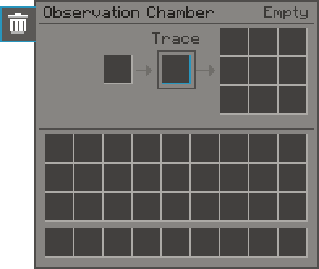

---
navigation:
  title: Observation Chamber
  parent: blocks/index.md
  position: 41
  icon: quantimium:observation_chamber
item_ids:
- quantimium:observation_chamber
---

# Observation Chamber

<ItemImage id="quantimium:observation_chamber" scale="2" />

The Observation Chamber collapses <ItemLink id="quantimium:unrealised_matter" /> into real ores. Put Matter in and pulse it with redstone.

- It needs no power. Each rising redstone edge collapses up to 4 Matter.
- Each Matter becomes one of your pack's ores, rarer in a hotter field. See [Unrealized Matter](../items/unrealised_matter.md).
- Each collapse has a 50% chance of a <ItemLink id="quantimium:quantimium_trace" /> as well, in its own slot. The **void** tab decides what happens when that slot is full: **Void** destroys the extra Trace and carries on, **Keep** stops and says **Full** until there is room, so no Trace is ever lost.
- Slots: one for Matter, one for Trace, nine for results.
- It works in a Quantum Simulator as any machine does.

For an automated version that runs on power, see the <ItemLink id="quantimium:quantum_observation_chamber" />.

## Recipes

<RecipesFor id="quantimium:observation_chamber" />
