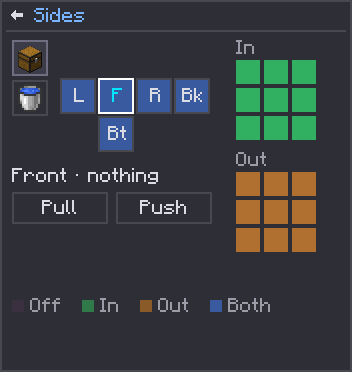

---
navigation:
  title: Side configuration
  parent: concepts/index.md
  position: 5
---

# Side configuration

Quantimium's automated machines let you set, face by face, what pipes, hoppers and neighboring
machines can put in and take out. The same **Sides** page is used on every machine
that has one, and a wrench can change it without opening anything.

| Machine | Items | Fluids | Faces |
| --- | --- | --- | --- |
| [Quantum Crafter](../machines/quantum-crafter.md) | Yes | No (every face fills its input tanks and drains its output tanks) | All six |
| [Quantum Simulator](../machines/quantum-simulator.md) | Yes | Yes | All but the top (the field) |
| [Tesseract Stabilizer](../machines/tesseract-stabilizer.md) | Yes | Yes | All but the top |

The Basic Quantum Crafter has no side configuration: every face is both an input and an output.

## Opening it

Every one of them has a **Sides** tab on the right of its screen. The page opens in the machine's own
frame; click the tab again, the back arrow by its title, or press Escape to go back.

## Faces

The six faces are laid out as an unfolded cube around the **Front**:
Left, Front, Right and Back across the middle, Top above and Bottom below. They are named from the
machine's own facing, not the compass, because every side of the block looks alike. Click a face to
pick it: under the net it shows what that face touches.

A face the machine can't automate (a Simulator's top) is left out of the net.

## Modes

Each face has a **mode** for items and, separately, for fluids (switch with
the chest and bucket buttons at its left):

| Mode | Things can go in | Things can come out |
| --- | --- | --- |
| **Off** | No | No |
| **In** | Yes | No |
| **Out** | No | Yes |
| **Both** | Yes | Yes |

The face tiles are colored by mode: dark for Off, green for In, orange for Out and blue for Both.
Right-click a face to step its mode on, shift-right-click to step back. Each change is saved as you make it.

| Machine | Items start as | Fluids start as |
| --- | --- | --- |
| Quantum Crafter | Both | (always both) |
| Quantum Simulator | Both | Off |
| Tesseract Stabilizer | Both | Both |

## Which slots a face reaches

On the Crafter and the Simulator, the **In** and **Out** grids on the right
choose which slots the picked face works on. Click a cell to allow or block it.

- **In** covers the nine input slots of the grid.
- **Out** covers the nine output slots. The Quantum Crafter has 54 outputs; each cell stands for every
  ninth of them (the first cell: outputs 1, 10, 19 and so on). Its ghosts (what it would make) go out of any
  face with at least one output cell on.
- On the **Fluids** tab the cells are the three input tanks and the three output tanks.
- A Tesseract Stabilizer has no slots of its own; its faces reach *all remote slots* the link
  exposes.

**Example.** A Simulator running a furnace, mapped so the odd grid slots take ore and the even
slots take fuel: set the top-facing hopper's face to **In** with only the odd cells, and a side face
to **In** with only the even cells. Ore and coal then arrive in the right slots from two hoppers.

## Automatic transfer

**Pull** and **Push** make a face move things by itself, without a
pipe. Once a second, a face with:

- **Pull** takes from the block beside it into the slots its In cells allow;
- **Push** puts from the slots its Out cells allow into the block beside it.

Pull needs a mode that allows input (In or Both), and Push one that allows output. Two small
dots on a face tile show which of the two it has on.

On a Quantum Crafter, Push **commits a craft** and pushes it, sized to the room the neighbor
has; see [Automation](../machines/quantum-crafter.md).

## With a wrench

Right-click a face of the machine with any wrench (any item in the
`#c:tools/wrench` tag, such as those from Modern Industrialization or Mekanism):

- **Click:** cycle that face's **item** mode: Off → In → Out → Both → Off.
- **Sneak-click:** cycle its **fluid** mode.

The wrench only changes the mode. Slot cells, Pull and Push stay on the page. A sneak-click
never dismantles or rotates a Quantimium machine, whatever the wrench does elsewhere.
